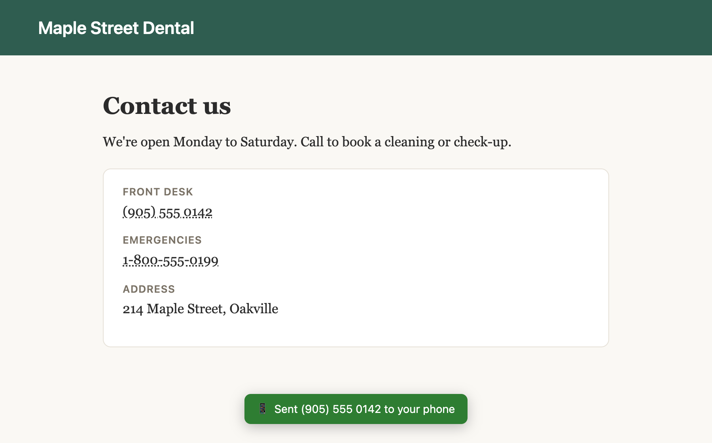
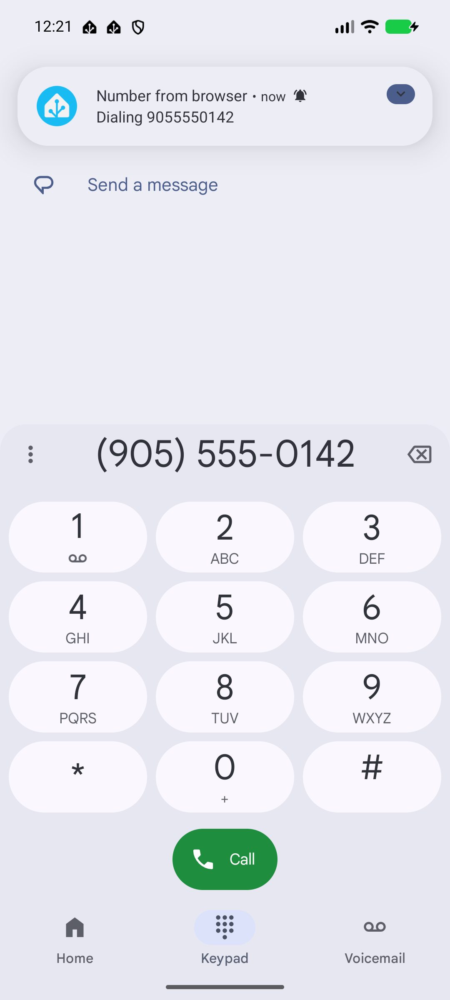
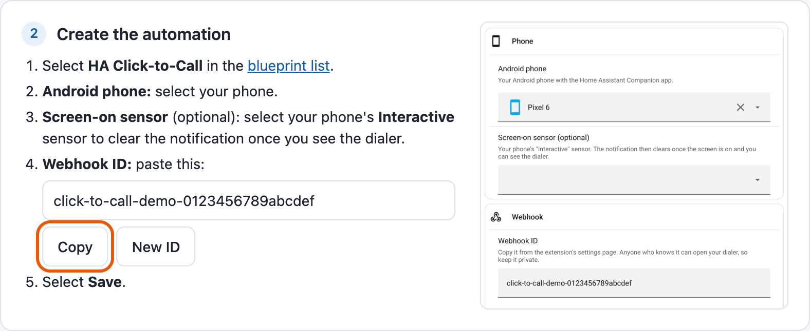
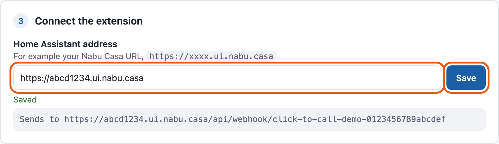
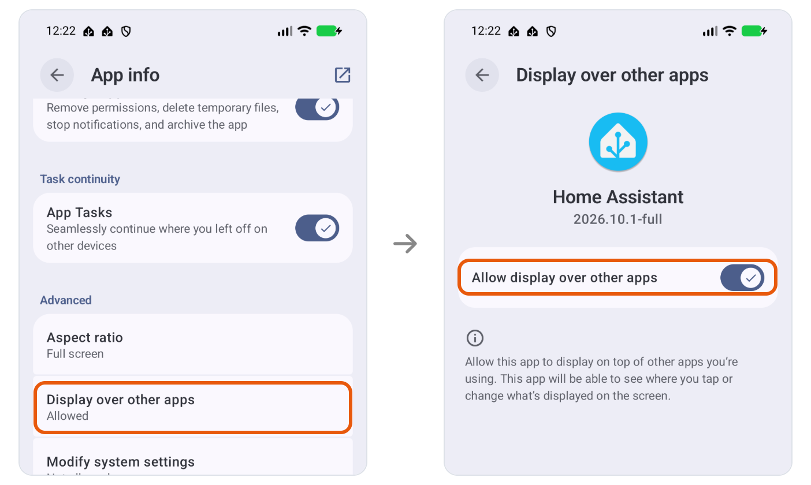
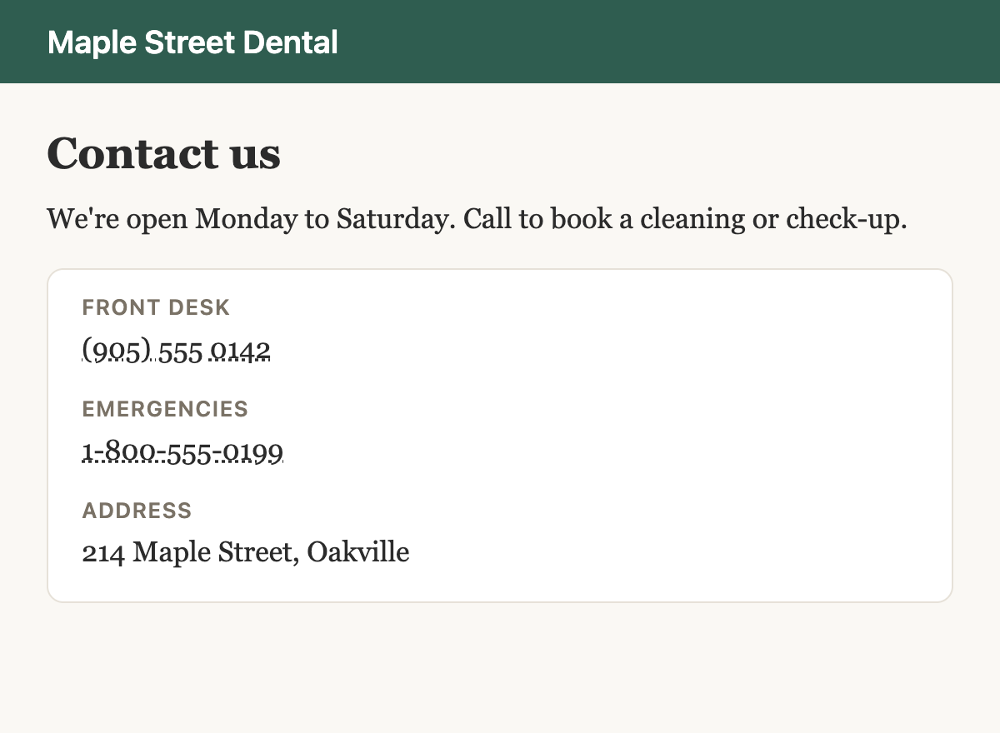

# HA Click-to-Call

Click to call phone numbers from your browser on your phone, using Home Assistant and the Home Assistant Companion
app.

  
  

## What you need
- [Home Assistant](https://www.home-assistant.io/).
- An Android phone with the [Home Assistant Companion app](https://companion.home-assistant.io/) installed.
- Google Chrome on your computer. Want another browser? [Open an issue](https://github.com/dk1/ha-click-to-call/issues).

## Set up
[Install the extension](#install), then click its icon in the toolbar to open the settings.

The extension will walk you through four steps, shown below:

**1. Add the blueprint to Home Assistant.**

**2. Create the automation.** Select **HA Click-to-Call** in the
[blueprint list](https://my.home-assistant.io/redirect/blueprints/), select your phone and paste the webhook ID
from the extension's settings.

**3. Connect the extension.** Enter your Home Assistant address, such as your Nabu Casa URL, and click
**Save**.

**4. Set up your phone.** On your phone, go to **Settings** > **Apps** > **Home Assistant** and turn on
**Display over other apps** (called **Appear on top** on some phones). Android needs this before an app can
open the dialer for you. Without it, you can tap the notification to open the dialer.

Then enter a number under **Try it** and click **Send to phone**.

## Install
The Chrome Web Store listing is on the way. Until then, or if you'd rather not install from a store, run it
straight from this repository.

### Run it from the source (no store)
The extension is a few hundred lines of plain JavaScript in the [`extension`](extension) folder, with no build
step and nothing downloaded at runtime, so you can read all of it before you load it.

1. Get the code: `git clone https://github.com/dk1/ha-click-to-call`, or **Code** > **Download ZIP** on this
   page and unzip it. Keep the folder: Chrome loads the extension from it.
2. In Chrome, go to `chrome://extensions`, turn on **Developer mode**, click **Load unpacked** and choose the
   `extension` folder.
3. To update, run `git pull` (or download the ZIP again into the same folder), then click the reload button on the
   extension in `chrome://extensions`. Your settings are kept.

## Use it

- Click any phone number link. Numbers that a site opens in your computer's phone app from its own code, like a business's number on Google Search, are sent too, and so is a place's number on Google Maps.
- To also click numbers that are only text, turn on **Make phone numbers without a `tel:` link clickable** in the
  extension's settings. They get a dotted underline. It's off by default because it changes the page, which a few
  sites don't handle well.
- Or select a number, right-click and choose **Call … on phone**.
- A message at the bottom of the page confirms it was sent. Your phone buzzes and opens the dialer. If the
  dialer doesn't open, tap the notification.
- Hold Alt (Option on a Mac) when you click to use your desktop's own phone app instead.

## Troubleshooting
- **The phone shows a permission prompt instead of the dialer:** allow the Home Assistant app to Display over
  other apps.
- **"Sent", but nothing happens on the phone:** open the automation in Home Assistant and check its traces.
  "Sent" means the number reached the address. The extension can't read Home Assistant's reply, and Home
  Assistant accepts any webhook ID anyway, so a mistyped ID still shows as "Sent".
- **Works at home but not away:** a home address like `http://homeassistant.local:8123` only works on your
  home network. Use your Nabu Casa URL instead, and turn off **Only accept calls from the local network** in the
  automation.
- **No vibration:** Android lets you change it under **Settings** > **Apps** > **Home Assistant** >
  **Notifications** > **Click-to-Call**.

## Options
The automation's **Behavior** section lets you place the call straight away instead of opening the dialer
(the Home Assistant app then needs the Phone permission), and change how long the notification stays.

## Privacy
The extension stores only your Home Assistant address and webhook ID, and sends only the number you click, to
your Home Assistant. It never sees a Home Assistant password or token. Anyone who knows
the webhook ID can open your phone's dialer, so treat it like a password. The automation accepts digits only,
so nothing else can be sent to your phone. See the [privacy policy](PRIVACY.md).

## Development
Screenshots in `docs/screenshots` are made by `dev/screenshots.mjs` against a throwaway Home Assistant in Docker
and the Android emulator, so no real data ends up in them. See the comments at the top of `dev/screenshots.mjs`
and `dev/docker-compose.yml`. `npm run store` in `dev` makes the store zip and listing
images; see [`store/LISTING.md`](store/LISTING.md).

CI runs `node dev/check-extension.mjs` and `python dev/check-blueprint.py` on every pull request and push to `main`.
